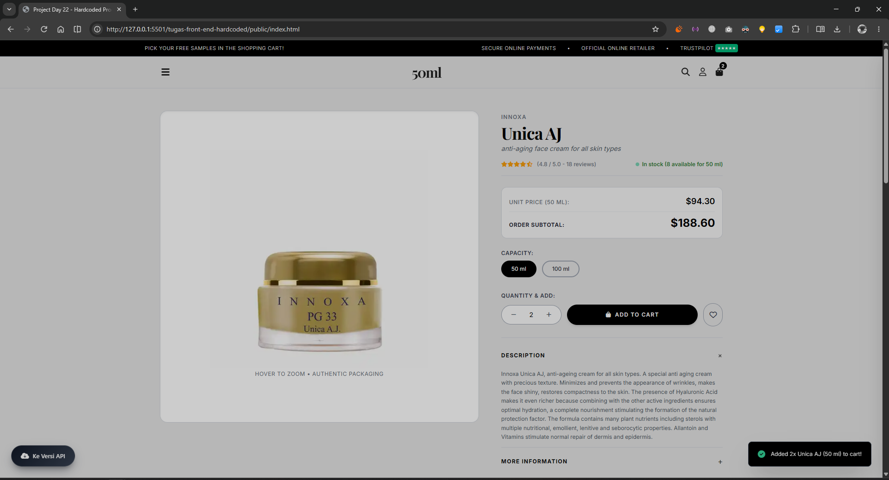
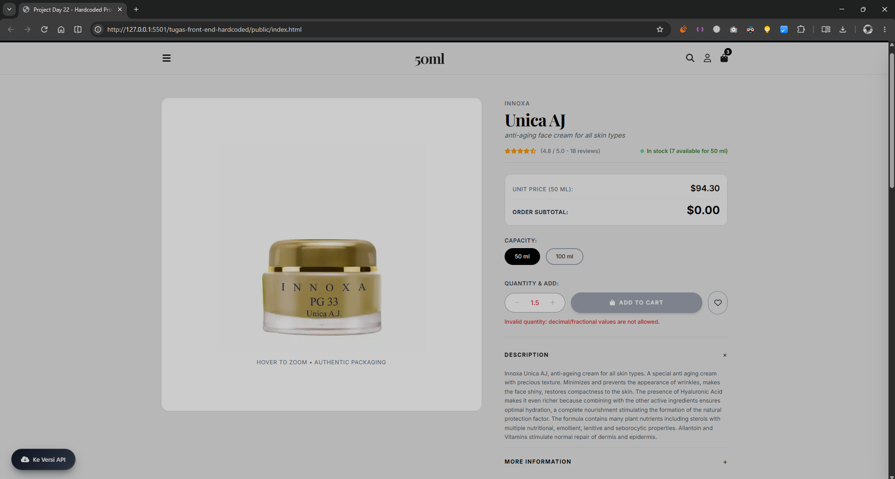
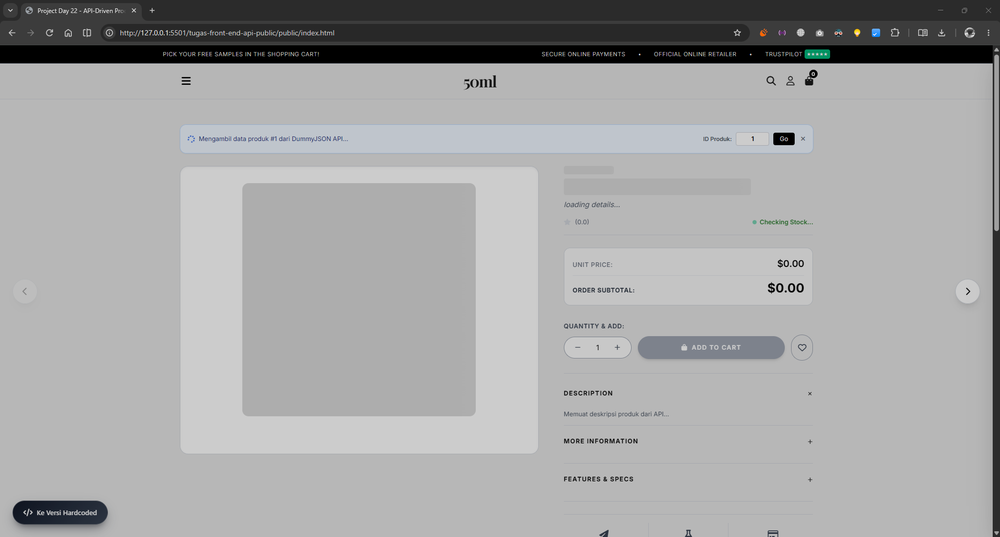
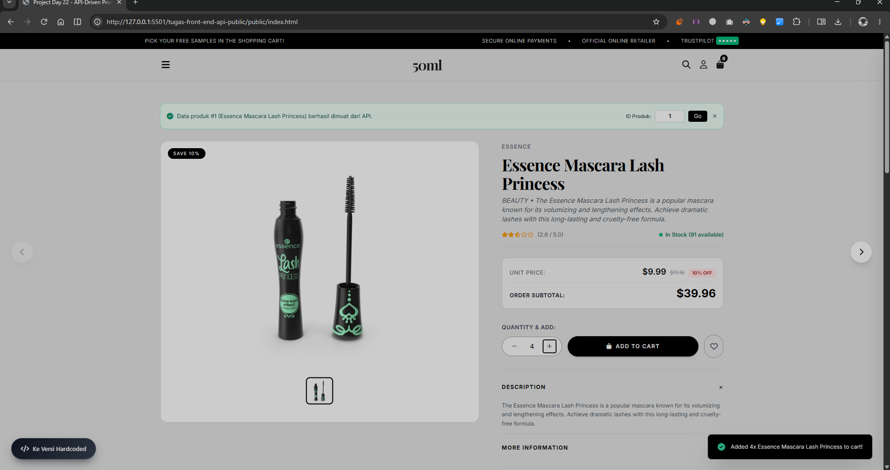
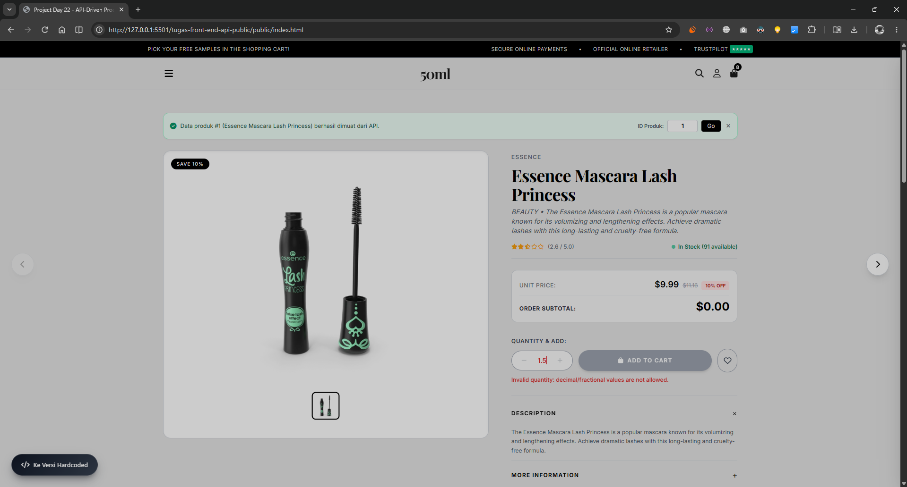
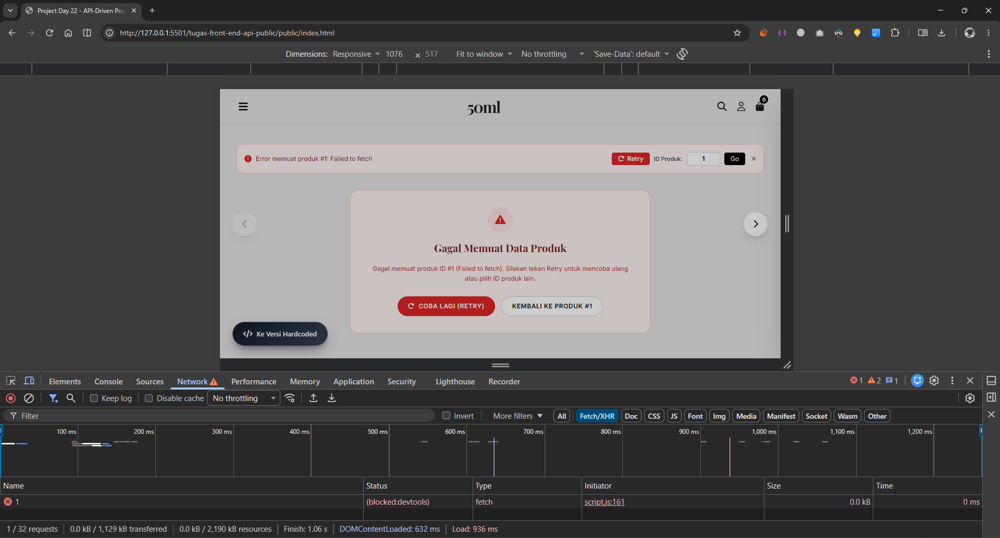

# Mini Project Full-Stack: Building Interactivity Website with JavaScript (Day 22)

Proyek ini merupakan kelanjutan dari **Study Case Phase 1** dengan menambahkan interaktivitas dinamis menggunakan JavaScript (DOM manipulation, _event handling_, validasi _input_, serta _asynchronous JavaScript_ menggunakan Fetch API) pada dua halaman detail produk e-commerce **50ml**.

## 1. Struktur Folder & Halaman

Sesuai dengan struktur _repository_, proyek ini mempertahankan dua checkpoint halaman detail produk dari Phase 1 yang terpisah ke dalam dua folder:

```text
├── dokumentasi-program-berjalan/       # Folder penyimpanan screenshot hasil pengujian
├── tugas-front-end-hardcoded/
│   └── public/
│       ├── assets/                     # Aset gambar produk lokal
│       ├── index.html                  # Halaman produk detail (Hardcoded)
│       ├── script.js                   # Logika DOM, variasi, stok per variasi & keranjang
│       └── style.css                   # Styling halaman hardcoded
├── tugas-front-end-api-public/
│   └── public/
│       ├── assets/                     # Aset pendukung
│       ├── index.html                  # Halaman produk detail (API-Driven)
│       ├── script.js                   # Logika Fetch API, loading/error state, validasi & keranjang
│       └── style.css                   # Styling halaman API-driven
└── README.md
```

### Rincian Sumber Data

1. **Halaman Produk Hardcoded (`tugas-front-end-hardcoded/public/index.html`)**
   - Menampilkan produk **Innoxa Unica AJ** menggunakan data lokal (_hardcoded_).

   - Menyediakan pilihan variasi kapasitas (**50 ml** seharga `$94.30` dengan stok `10`, dan **100 ml** seharga `$150.88` dengan stok `5`) yang dikelola secara independen per variasi.

2. **Halaman Produk API-Driven (`tugas-front-end-api-public/public/index.html`)**
   - Mengambil data produk secara _asynchronous_ menggunakan Fetch API dari endpoint _baseline_ **DummyJSON** (`https://dummyjson.com/products/{id}`).

   - Memetakan metadata produk (`title`, `brand`, `category`, `description`, `price`, `discountPercentage`, `rating`, `stock`, `images`, `sku`, informasi garansi/pengiriman/retur, serta ulasan pelanggan) langsung ke DOM.

   - Menggunakan nilai `stock` total langsung dari API tanpa mengasumsikan pembagian stok per variasi.

## 2. Teknologi & Library yang Digunakan

- **HTML5 & CSS3 / Tailwind CSS (CDN)**

- **JavaScript (Vanilla ES6+)** — `addEventListener`, `textContent`, `async/await`, `Fetch API`, dan `AbortController`

- **Lodash 4.18.1 (CDN)** — digunakan untuk pembulatan kalkulasi harga (`_.round`) dan sanitasi teks tampilan (`_.escape`)

- **Font Awesome 6.4.0 & Google Fonts (Inter & Playfair Display)**

## 3. Fitur Interaksi & Asynchronous Handling

### A. Interaksi DOM & Validasi (Kedua Halaman)

- **Pemilihan Variasi & Kalkulasi Subtotal Real-Time**: Mengubah variasi kapasitas (pada halaman _hardcoded_) atau mengubah jumlah (_quantity_) langsung memperbarui harga satuan dan **Order Subtotal** pada ringkasan pesanan menggunakan `textContent`.

- **Validasi Quantity Ketat**:
  - Hanya menerima **bilangan bulat positif** ($\ge 1$) dan **tidak melebihi sisa stok** yang tersedia.

  - Menolak input kosong, `0`, bilangan negatif, bilangan pecahan/desimal, serta jumlah di atas stok dengan menampilkan pesan error merah secara langsung dan menonaktifkan tombol **ADD TO CART**.

- **Keranjang Belanja Lokal (_Local Cart Drawer_)**:
  - Menambahkan item valid akan memperbarui _badge_ jumlah keranjang (_cart count_), menghitung subtotal keranjang, mengurangi sisa stok yang tersedia untuk pemesanan berikutnya, dan menampilkan notifikasi _toast_.

  - Mendukung penghapusan item keranjang menggunakan _event delegation_ (`addEventListener`) yang otomatis mengembalikan ketersediaan stok.

- **Interaksi Pendukung**: Accordion informasi produk (_Description_, _More Information_, _Features & Specs_), _wishlist toggle_, galeri _thumbnail_ (pada halaman API), serta formulir ulasan (_star rating picker_ + validasi input).

### B. Asynchronous JavaScript & Error Handling (`tugas-front-end-api-public/public/index.html`)

- **Loading State**: Menampilkan _banner_ status pemuatan dan _skeleton loader_ pada gambar, merek, dan judul selama proses `fetch` berlangsung.

- **Validasi HTTP & Penanganan Error (`response.ok`)**: Memeriksa `response.ok` sebelum mem-parsing `response.json()`. Jika ID produk tidak ditemukan (HTTP 404) atau jaringan bermasalah, seluruh indikator _loading_ dihentikan dan halaman menampilkan **Error State** beserta tombol **Retry**.

- **Pencegahan Request Duplikat**: Menggunakan `AbortController` untuk membatalkan _request_ sebelumnya apabila pengguna berpindah produk secara cepat, serta memasang seluruh _event listener_ hanya satu kali saat `DOMContentLoaded`.

## 4. Cara Menjalankan Proyek

1. _Clone_ atau unduh repository ini ke komputer lokal:

   ```bash
   git clone https://github.com/ilhamdwiputranto/Mini_Project_Day5_FWD13_IlhamDwiPutranto.git
   cd Mini_Project_Day5_FWD13_IlhamDwiPutranto
   ```

2. Buka folder proyek menggunakan **Visual Studio Code**.

3. Jalankan menggunakan ekstensi **Live Server** pada masing-masing folder halaman:
   - **Halaman Hardcoded**: Klik kanan pada `tugas-front-end-hardcoded/public/index.html` $\rightarrow$ _Open with Live Server_.

   - **Halaman API-Driven**: Klik kanan pada `tugas-front-end-api-public/public/index.html` $\rightarrow$ _Open with Live Server_.

   - Pastikan perangkat terhubung ke internet agar CDN Tailwind CSS, Lodash 4.18.1, Font Awesome, dan DummyJSON API dapat dimuat.

## 5. Cara Menguji & Tabel Hasil Pengujian

### Langkah Pengujian

1. **Halaman Hardcoded (`tugas-front-end-hardcoded/public/index.html`)**: Ubah variasi kapasitas (`50 ml` / `100 ml`), ubah nilai _quantity_ dengan angka valid maupun tidak valid (`0`, `-2`, `1.5`, `99`), lalu klik **ADD TO CART** dan periksa perubahan _subtotal_, sisa stok per variasi, serta _cart badge_.

2. **Halaman API-Driven (`tugas-front-end-api-public/public/index.html`)**: Muat halaman awal (Produk `#1`), gunakan tombol panah kiri/kanan di tepi layar untuk berpindah produk, uji input ID tidak valid (misal `9999`) pada kolom **ID Produk** lalu klik **Go** untuk memicu _error state_, dan klik tombol **Retry**.

### Tabel Skenario Pengujian Minimum

| No  | Halaman                                        | Skenario / Input Pengujian                                                    | Expected Result                                                                                                                                     | Actual Result                                                        | Status |
| --- | ---------------------------------------------- | ----------------------------------------------------------------------------- | --------------------------------------------------------------------------------------------------------------------------------------------------- | -------------------------------------------------------------------- | ------ |
| 1   | `tugas-front-end-hardcoded/public/index.html`  | Pilih variasi `100 ml` dan ubah _quantity_ menjadi `2`                        | Harga satuan menjadi `$150.88`, sisa stok `5 available`, dan **Order Subtotal** berubah menjadi `$301.76`                                           | Harga satuan `$150.88`, stok `5 available`, Order Subtotal `$301.76` | Pass   |
| 2   | `tugas-front-end-hardcoded/public/index.html`  | Input _quantity_ `0` atau bilangan negatif (`-3`)                             | Muncul pesan error validasi merah, subtotal menjadi `$0.00`, dan tombol **ADD TO CART** nonaktif                                                    | Pesan error muncul & tombol **ADD TO CART** nonaktif                 | Pass   |
| 3   | `tugas-front-end-hardcoded/public/index.html`  | Input _quantity_ pecahan/desimal (`1.5`)                                      | Input ditolak dengan pesan error bahwa nilai desimal tidak diizinkan; tombol **ADD TO CART** nonaktif                                               | Input ditolak dengan pesan error & tombol nonaktif                   | Pass   |
| 4   | `tugas-front-end-hardcoded/public/index.html`  | Input _quantity_ melebihi stok (`15` pada varian `50 ml` yang stoknya `10`)   | Input ditolak dengan pesan bahwa jumlah melebihi stok maksimum (`10`); tombol **ADD TO CART** nonaktif                                              | Input ditolak dengan pesan batas stok & tombol nonaktif              | Pass   |
| 5   | `tugas-front-end-hardcoded/public/index.html`  | Input _quantity_ valid (`3` pada `50 ml`), lalu klik **ADD TO CART**          | _Toast_ sukses muncul, _cart badge_ bertambah menjadi `3`, dan sisa stok `50 ml` berkurang menjadi `7` (stok `100 ml` tetap `5`)                    | _Toast_ muncul, _cart badge_ `3`, sisa stok `50 ml` menjadi `7`      | Pass   |
| 6   | `tugas-front-end-api-public/public/index.html` | Buka halaman pertama kali atau klik tombol panah produk selanjutnya           | _Banner_ biru & _skeleton loading_ muncul sementara, lalu data produk dari `dummyjson.com/products/{id}` dirender dan banner hilang setelah 3 detik | _Loading_ tampil lalu data produk API dirender dengan benar          | Pass   |
| 7   | `tugas-front-end-api-public/public/index.html` | Masukkan ID produk tidak valid (`9999`) pada input ID Produk lalu klik **Go** | Request gagal (`HTTP 404`), seluruh _skeleton loading_ berhenti/hilang, dan tampil _Error State_ dengan tombol **Retry**                            | _Skeleton_ hilang, tampil kartu _Error State_ & tombol **Retry**     | Pass   |
| 8   | `tugas-front-end-api-public/public/index.html` | Klik tombol **Retry** atau **Kembali ke Produk #1** setelah terjadi error     | Melakukan satu kali request ulang, memuat data produk kembali normal tanpa duplikasi _request_ maupun _event listener_                              | Data produk #1 berhasil dimuat ulang tanpa duplikasi                 | Pass   |
| 9   | `tugas-front-end-api-public/public/index.html` | Input _quantity_ valid pada produk API lalu klik **ADD TO CART**              | _Subtotal_ terhitung sesuai harga API, _cart badge_ bertambah, dan sisa stok produk berkurang sesuai jumlah yang dibeli                             | _Subtotal_, _cart badge_, dan sisa stok diperbarui sesuai API        | Pass   |

## 6. Bukti Output / Screenshot Browser

### 1. Halaman Hardcoded (`tugas-front-end-hardcoded/public/index.html`)

- **Tampilan Produk, Variasi, Subtotal & Tambah ke Keranjang (Valid):**

  

- **Validasi Input Quantity Tidak Valid (`0` / Pecahan / Negatif / Melebihi Stok):**

  

### 2. Halaman API-Driven (`tugas-front-end-api-public/public/index.html`)

- **Loading State (Skeleton Loader & Status Fetch API):**

  

- **Render Sukses Data Produk dari DummyJSON API:**

  

- **Validasi Input Quantity Tidak Valid pada Produk API:**

  

- **Error State (ID Produk `9999` / HTTP 404) & Tombol Retry:**

  

## 7. Catatan Penggunaan AI

Dalam pengerjaan assignment ini, AI digunakan sebagai asisten _code review_ untuk:

- Memeriksa kesesuaian kode dengan seluruh kriteria pada panduan tugas (validasi bilangan bulat positif, pembaruan subtotal menggunakan `textContent`, penggunaan `addEventListener`, dan penanganan `response.ok`).

- Merapikan struktur penanganan _loading state_, _error state_, dan pencegahan duplikasi _request_ (`AbortController`) pada halaman API-driven.

- Seluruh kode telah diuji dan diverifikasi secara mandiri pada browser sesuai skenario pengujian di atas.
